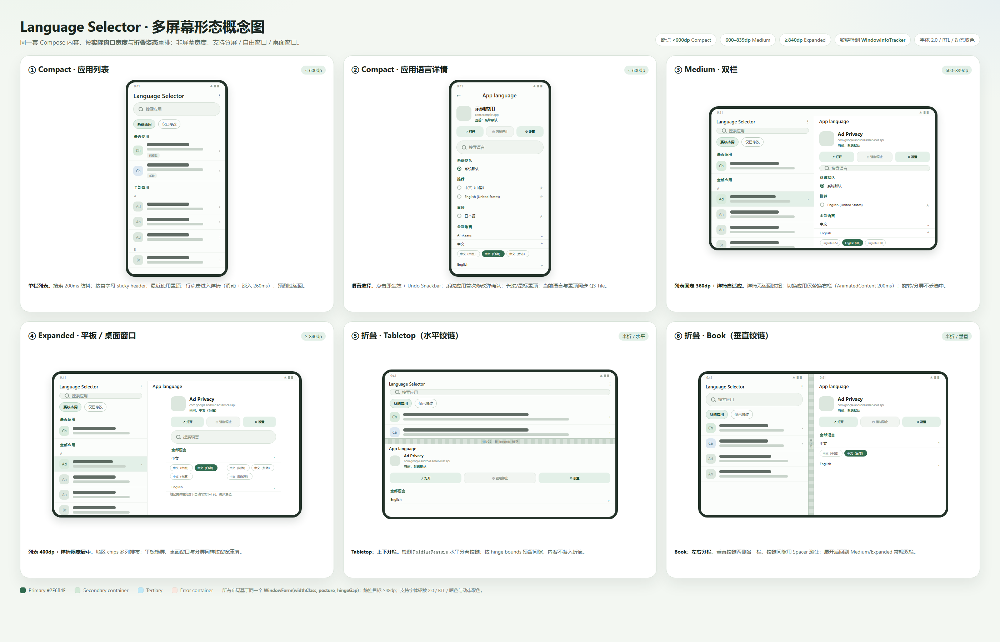
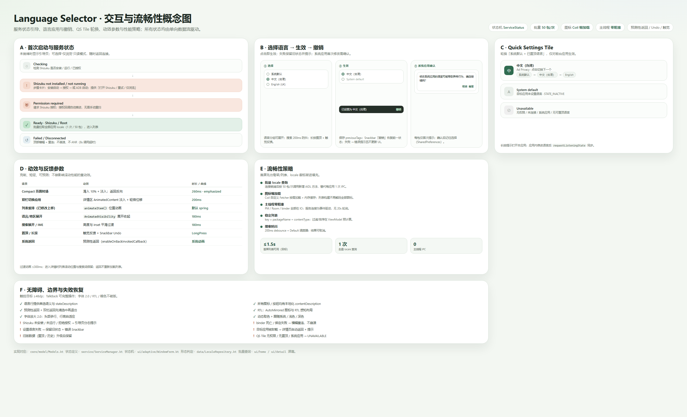

## Language Selector

Language Selector sets an individual language for any installed app, replicating the "App languages"
feature of Android 13+ even on ROMs that do not expose it (for example MIUI). It uses
[Shizuku](https://shizuku.rikka.app/) to call the system `LocaleManager` service at privileged level;
an optional Root mode is available for devices without Shizuku.

> The app does **not** translate other apps. It only sets the locale an app will use. If the target app
> ships the requested language, it will show it; otherwise the app may ignore the setting.

### Requirements

- Android 16 (API 36) or higher. `minSdk`/`targetSdk` are pinned to 36.
- Shizuku installed and running (recommended), **or** Root access (Magisk/KernelSU etc.).
- Language Selector granted Shizuku permission.

### Features

- Set / read / reset per-app locales for user and system apps.
- Adaptive UI for many screen forms:
  - phones (portrait and landscape)
  - foldables: two-pane when unfolded, hinge-aware tabletop/book postures
  - tablets and desktop windows (medium/expanded width classes)
  - split screen / freeform multi-window, dynamic font scale and RTL
- Smooth interaction: lazy icon loading (Coil), one batched locale query for all apps,
  debounced search, stable list keys, predictive back and lightweight transitions.
- Language picker with suggested (system) languages, pinned languages and all available
  languages grouped by language with region variants.
- Quick Settings tile: cycles the pinned languages for the foreground app.
- Recently used apps, app filters (system / modified) and app search.
- Root mode as a fallback when Shizuku is not available.

### Design concepts





The concept boards above summarise the responsive layout matrix (compact / medium / expanded /
tabletop / book), the interaction model (apply + undo, system-app confirmation, QS tile states) and the
motion/performance budget. Editable sources are in `other/concepts/`.

### Usage

1. Install and start Shizuku, then open Language Selector.
2. Grant Shizuku permission (or choose Root mode).
3. Pick an app from the list.
4. Choose "System default", a suggested/pinned language, or any language from the full list.
5. The new locale is applied immediately; force-stopping the target app is optional.

Long-press (or tap the star of) a language to pin it. Pinned languages appear at the top of the
picker and are available in the Quick Settings tile.

### Build

```powershell
# JDK 21 is required (Gradle toolchain is pinned to Microsoft JDK 21 in this repo)
$env:JAVA_HOME = "C:\Program Files\Microsoft\jdk-21.0.12.101-hotspot"
.\gradlew.bat :app:assembleDebug      # debug APK
.\gradlew.bat :app:assembleRelease    # minified APK (debug signing config)
.\gradlew.bat :app:testDebugUnitTest  # unit tests
.\gradlew.bat :app:lintDebug          # Android lint
```

### Architecture

```
app/src/main/java/vegabobo/languageselector/
├── core/       models, contracts, dispatchers, locale utilities
├── service/    Shizuku/Root binding, ServiceManager state machine, AIDL user service
├── data/       app catalog, locale state cache, locale catalog, pinned store, Room history
├── qs/         Quick Settings tile
├── di/         Hilt bindings
└── ui/         Material 3 theme, adaptive scaffold, screens (home/detail/onboarding/about),
                reusable components
```

- `ServiceManager` exposes a `StateFlow<ServiceStatus>` and serializes privileged calls with a mutex
  and timeouts; the UI never blocks on service discovery.
- Locale state for all installed apps is fetched in one batched binder call after the service is
  ready, then updated in place after each change.
- The UI is driven by immutable state from `ViewModel`s and `StateFlow`s; the layout is chosen from
  the current window width class plus folding posture (`androidx.window`).

### Notes / limitations

- Verified on Android 17 (Xiaomi) with Shizuku 13.6.0; Android 16 is the minimum supported version.
- Upgrading from the pre-rewrite 1.05 release keeps history, pinned languages and modified-app state
  (database version 1 is migrated to 2 in place).
- Only the current Android user is supported (multi-user / work-profile apps are not listed).
- Changing the language of system apps can cause unexpected behavior; a warning is shown first.
- Release builds use the debug signing config (personal use). Provide your own keystore for distribution.
- The `hidden_api` module contains compile-only stubs of the framework classes used through Shizuku;
  it is not packaged into the APK.

### Credits

This rewrite is based on the original
[Language Selector](https://github.com/VegaBobo/Language-Selector) by VegaBobo (Apache-2.0).
